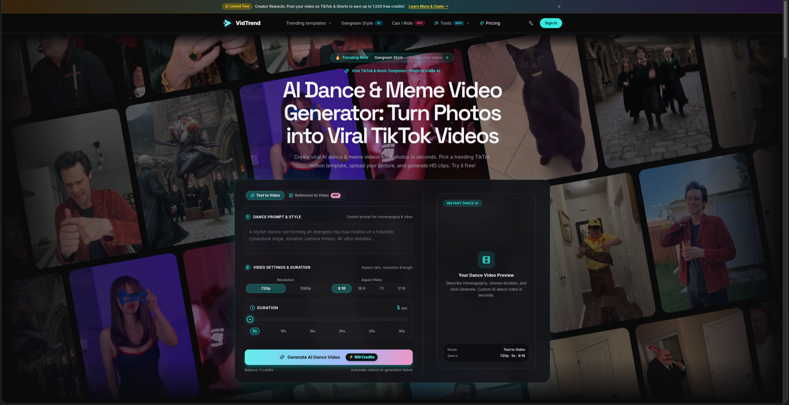
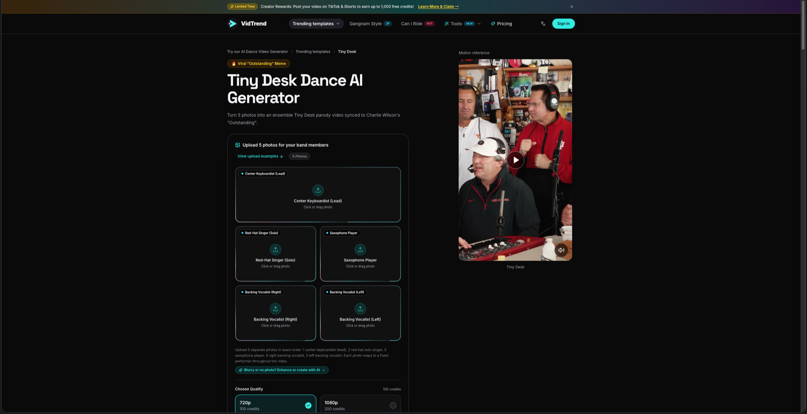
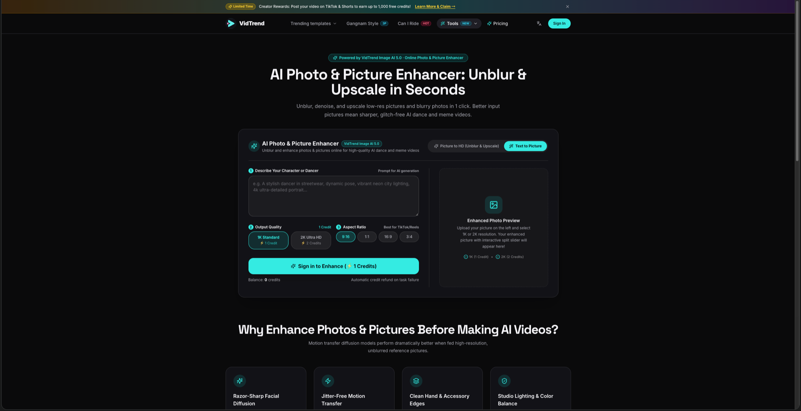
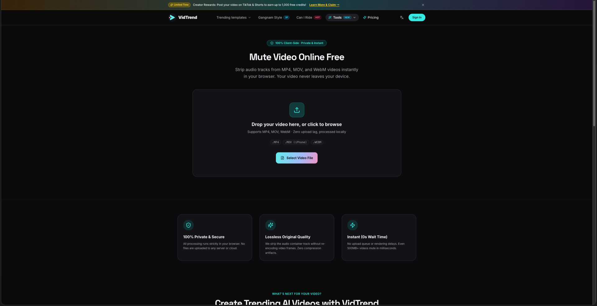

# Awesome AI Dance Memes 🕺💃

[](https://awesome.re)
[](LICENSE)
[](https://vidtrend.app)
[](https://github.com/ice45571/awesome-ai-dance-memes/pulls)

A curated list of viral TikTok AI dance memes, multi-character generators, motion transfer workflows, prompt recipes, and production guides. Turn static photos of yourself, friends, pets, or characters into high-engagement viral video memes in minutes.

Powered by [VidTrend](https://vidtrend.app) — the 1-click viral short-form AI video generation engine and creative studio.

---

## 📑 Table of Contents

- [🖼️ Visual UI Tour & Feature Screenshots](#️-visual-ui-tour--feature-screenshots)
  - [1. Universal AI Video Studio & Prompt Workbench](#1-universal-ai-video-studio--prompt-workbench)
  - [2. Multi-Character Viral Trend Template Studio](#2-multi-character-viral-trend-template-studio)
  - [3. Neural Engine 5.0 AI Photo Enhancer & Avatar Creator](#3-neural-engine-50-ai-photo-enhancer--avatar-creator)
  - [4. Zero-Latency Client-Side Video Muter](#4-zero-latency-client-side-video-muter)
- [✨ Core Capabilities & Platform Architecture](#-core-capabilities--platform-architecture)
- [🚀 Featured Templates & Live Demos](#-featured-templates--live-demos)
- [📚 In-Depth Tutorials & Deep Dives](#-in-depth-tutorials--deep-dives)
  - [First Time Fancy Cafe AI (POV Cafe Meme)](#first-time-fancy-cafe-ai-pov-cafe-meme)
  - [Gangnam Style Dance AI](#gangnam-style-dance-ai)
  - [Tiny Desk Concert Dance AI](#tiny-desk-concert-dance-ai)
  - [Can I Ride Dance AI](#can-i-ride-dance-ai)
  - [TikTok Bad Times Dance AI](#tiktok-bad-times-dance-ai)
  - [The Jawn Dance AI](#the-jawn-dance-ai)
  - [Toc Toc Dance AI](#toc-toc-dance-ai)
  - [Head Bop Dance AI](#head-bop-dance-ai)
- [⚡ Workflow Comparison: DIY Manual vs. VidTrend 1-Click AI](#-workflow-comparison-diy-manual-vs-vidtrend-1-click-ai)
- [🎯 Short-Form Virality & TikTok Algorithm Playbook](#-short-form-virality--tiktok-algorithm-playbook)
- [💰 Creator Rewards & Transparent Credit Economy](#-creator-rewards--transparent-credit-economy)
- [🛠️ Quickstart Guide](#️-quickstart-guide)
- [🤝 Contributing & Adding New Blogs](#-contributing--adding-new-blogs)
- [📄 License](#-license)

---

## 🖼️ Visual UI Tour & Feature Screenshots

Explore the four core creation surfaces powering the VidTrend viral AI video ecosystem:

### 1. Universal AI Video Studio & Prompt Workbench

*Generate custom AI dance and cinematic videos using descriptive text prompts or motion transfer from reference videos.*

[](https://vidtrend.app)

* **Dual Generative Modes:**
  * **Text to Video:** Craft choreography, camera angles, lighting, and vibes from text prompts.
  * **Reference to Video [HOT]:** Upload any reference dance/action video (MP4/MOV up to 50MB) + 1–10 photos to retarget complex choreography onto custom subjects.
* **Granular Production Settings:**
  * **Aspect Ratios:** `9:16` (TikTok/Reels/Shorts), `16:9` (YouTube/widescreen), `1:1` (feed square), and `21:9` (cinematic ultrawide).
  * **Durations:** 5s, 10s, 15s, 20s, 25s, up to 30s.
  * **Resolutions:** 720p HD and 1080p Ultra HD.
* **Real-Time Studio Card:** Instant parameter verification, dynamic credit calculation, and automatic refund protection on generation failure.

---

### 2. Multi-Character Viral Trend Template Studio

*Turn multi-person friend groups, colleagues, or fandom characters into synchronized viral memes with frame-accurate multi-angle cuts.*

[](https://vidtrend.app/trends/tiny-desk-dance-ai)

* **Multi-Role Neural Rigging:** Dedicated photo upload slots for individual band or ensemble members (e.g. 5 distinct slots in [Tiny Desk](https://vidtrend.app/trends/tiny-desk-dance-ai), 3 slots in [Gangnam Style](https://vidtrend.app/trends/gangnam-style-dance-ai)).
* **Synchronized Audio & Camera Cuts:** Includes licensed or trending background music, synchronized audio drops, and dynamic camera angle switching.
* **Integrated Photo Prep Bridge:** One-click `✨ Blurry or no photo? Enhance or create with AI ➔` button bridges directly into the photo enhancer without manual file transfers.

---

### 3. Neural Engine 5.0 AI Photo Enhancer & Avatar Creator

*Eliminate blurry inputs, motion artifacts, and face-melting before feeding images into video diffusion models.*

[](https://vidtrend.app/tools/ai-photo-enhancer)

* **Picture to HD (Unblur & Upscale):** One-click facial restoration and super-resolution up to **1K Standard** or **2K Ultra HD**, restoring crisp skin textures, eyes, and studio lighting while strictly locking facial identity.
* **Text to Picture Avatar Studio:** Generate photorealistic dancers, anime avatars, or stylized characters from scratch with custom aspect ratios (`9:16`, `1:1`, `16:9`, `3:4`).
* **Direct Video Generation Bridge:** Enhanced images apply directly into the video generator in 1 click (`photo-bridge.ts`).

---

### 4. Zero-Latency Client-Side Video Muter

*100% private, browser-based WebAssembly (WASM) utility for stripping audio tracks from MP4, MOV, and WebM videos.*

[](https://vidtrend.app/tools/mute-video)

* **100% In-Browser & Private:** Processing runs entirely inside the client sandbox using WebAssembly — your private footage never touches external cloud servers.
* **Lossless Container Stripping:** Strips the audio stream without re-encoding video frames, guaranteeing zero quality degradation or compression artifacts.
* **TikTok Algorithm Optimization:** Enables posting clean silent MP4s so creators can attach official trending sounds directly inside TikTok or Instagram Reels to trigger algorithm recommendation loops.

---

## ✨ Core Capabilities & Platform Architecture

```
┌────────────────────────────────────────────────────────────────────────┐
│                        VidTrend Platform Engine                        │
├───────────────────────┬───────────────────────┬────────────────────────┤
│  1-Click Trend Memes  │   Universal Studio    │     Image AI 5.0       │
│  - Fancy Cafe (2-slot)│  - Text-to-Video      │  - Face Restoration    │
│  - Tiny Desk (5-slot) │  - Video-to-Video     │  - 1K/2K Super-Res     │
│  - Gangnam Style (3P) │  - 5s–30s Durations   │  - Text-to-Picture     │
│  - Can I Ride (1-pic) │  - 9:16 / 16:9 / 21:9 │  - Direct Video Bridge │
│  - Lip-sync & Bops    │                       │                        │
├───────────────────────┴───────────────────────┴────────────────────────┤
│           Client-Side Utilities: WASM Muter & Audio Tools              │
│       Creator Rewards: Post on TikTok/Shorts for Free Credits          │
└────────────────────────────────────────────────────────────────────────┘
```

1. **Preset Choreography Engine:** Curated TikTok dance trends updated weekly with pre-trained motion vectors, eliminating prompt trial-and-error.
2. **Multi-Identity Face Preservation:** Proprietary facial landmark tracking retains >98% facial identity, hairstyle, and attire consistency across fast camera cuts.
3. **No-Lock-In Credit Economy:** Transparent pay-as-you-go credit packs where purchased credits **never expire**.
4. **Watermark-Free Export:** All generated videos export as clean, broadcast-ready MP4 files.

---

## 🚀 Featured Templates & Live Demos

Test and run these viral AI dance templates directly in your browser:

| Template | Input | Duration | Audio / Sound | Description | Live Demo |
| :--- | :--- | :--- | :--- | :--- | :--- |
| **First Time Fancy Cafe AI** | 2 Photos (Awkward Man & Woman) | 21s | Original Cafe Ambiance & Audio | Viral "POV: Your first time in a fancy cafe" comedy meme with awkward seating reveal and reaction cuts. | [**Try Template ➔**](https://vidtrend.app/trends/first-time-fancy-cafe-ai) |
| **Gangnam Style Dance AI** | 3 Photos (Trio / 3 Members) | 10s | PSY - *Gangnam Style (TikTok Remix)* | 3-person synchronized horse-riding dance meme in a Hogwarts castle courtyard setting. | [**Try Template ➔**](https://vidtrend.app/trends/gangnam-style-dance-ai) |
| **Tiny Desk Dance AI** | 5 Photos (Full Band) | 15s | Charlie Wilson - *Outstanding* | Multi-person ensemble parody with dynamic 4-angle cuts (Lead, Singer, Sax, Backing Vocalists). | [**Try Template ➔**](https://vidtrend.app/trends/tiny-desk-dance-ai) |
| **Can I Ride Dance AI** | 1 Photo | 10s | SIDEPIECE & 95 South - *Can I Ride* | Viral hallway shuffle and fluid footwork trend popularized by @minicaseoh6741. | [**Try Template ➔**](https://vidtrend.app/trends/can-i-ride-dance-ai) |
| **TikTok Bad Times AI** | 1 Photo | 15s | Imael Angel - *Bad Times* (*Ça va barder!!*) | Viral expressive dance & facial lip-sync trend for pets and stylized characters. | [**Try Template ➔**](https://vidtrend.app/trends/tiktok-bad-times-imael-angel-ai-video) |
| **The Jawn Dance AI** | 1 Photo | 12s | Philly Bop / Hip-Hop | High-energy bouncing groove with fluid arm swings and footwork. | [**Try Template ➔**](https://vidtrend.app/trends/the-jawn-dance-ai) |
| **Toc Toc Dance AI** | 1 Photo | 12s | Viral TikTok Pop Dance | Rhythmic popping and locking choreography with crisp beat hits. | [**Try Template ➔**](https://vidtrend.app/trends/toc-toc-dance-ai) |
| **Head Bop Dance AI** | 1 Photo | 13s | Rhythmic Beat Sync | Catchy synced head-bobbing meme for animals, gaming avatars, and portraits. | [**Try Template ➔**](https://vidtrend.app/trends/head-bop-dance-ai) |
| **Middle Finger Dunk Video** | 2 Photos (Dunker & Defender) | 11s | Arena Roar & Rim Impact | Dual-character posterizer slam-dunk meme with rim rattle and crowd explosion. | [**Try Template ➔**](https://vidtrend.app/trends/middle-finger-dunk-video) |
| **Dime Dime Baby AI** | 1 Photo | 8s | Bby Wow | Energetic Latin-groove TikTok dance meme with rapid torso shifts. | [**Try Template ➔**](https://vidtrend.app/trends/dime-dime-baby) |

👉 **[Explore All Trending AI Video Templates on VidTrend](https://vidtrend.app/trends)**

---

## 📚 In-Depth Tutorials & Deep Dives

Curated long-form guides, engineering breakdowns, case studies, and virality playbooks published across top platforms.

### First Time Fancy Cafe AI (POV Cafe Meme)

*2-character viral comedy parody: turns 2 portrait photos into the 21-second viral sensation "POV: Your first time in a fancy cafe" with original audio and seating reveal.*

- ☕ [**First Time Fancy Cafe AI Live Generator & Specifications**](https://vidtrend.app/trends/first-time-fancy-cafe-ai)
- 🎭 **Two-Character Neural Slot Mapping:**
  - **Slot 1 (The Man on Left):** Awkwardly sitting sideways on the small concrete cafe ledge while sipping from a paper cup.
  - **Slot 2 (The Woman on Right):** Gracefully enters the frame, walks past him, and sits properly behind the round metal cafe table.
- 🎬 **Scene Preservation & Cinematic Timing:**
  - Powered by **Kling v4 Omni Reference Edit**.
  - Strict 21-second narrative arc: initial awkward sip, woman's entrance, man's realization glance, comical readjustment to face forward, and dual reaction finish.
  - Zero character blending: individual facial identities, hairstyles, clothing, and accessories strictly maintained throughout camera movements.
- 🔊 **Authentic Audio Continuity:**
  - Preserves the original cafe footsteps, paper cup handling sound effects, and ambient coffee shop room tone.
- ⚡ **Resolution & Rendering:**
  - Available in **720p HD** (100 credits) and **1080p Ultra HD** (200 credits).

---

### Gangnam Style Dance AI

*3-person synchronized horse-riding dance meme: turns 3 distinct portraits into a cohesive Hogwarts courtyard trio parody with synced PSY audio.*

- 🏇 [**Gangnam Style Dance AI Live Generator & Specifications**](https://vidtrend.app/trends/gangnam-style-dance-ai)
- 🛠️ **DEV.to** (`Builder Workflow & QA`):  
  [**Gangnam Style Dance AI for Builders: Three Slots, One Synced Export, and a Multi-Identity QA Checklist**](https://dev.to/vidtrend/gangnam-style-dance-ai-for-builders-three-slots-one-synced-export-and-a-multi-identity-qa-2b4j)  
  *Engineering breakdown of 3-slot identity anchoring, Hogwarts courtyard background preservation, and frame-accurate horse dance synchronization.*
- 📊 **Medium** (`Case Study & Casting Chemistry`):  
  [**Why Gangnam Style Trio Memes Work in 2026: Hallway Horse Dance, Hogwarts Casting Chemistry, and Soft CTAs**](https://medium.com/@ice45571/why-gangnam-style-trio-memes-work-in-2026-hallway-horse-dance-hogwarts-casting-chemistry-and-069d095a84ee)  
  *In-depth case study examining why 3-character parody chemistry drives viral share loops and comment engagement across TikTok & Reels.*
- 🇯🇵 **note.com** (`日本語ガイド`):  
  [**【作り方】写真3枚で江南スタイル3人組ダンスAI｜音源同梱・透かしなし（アジア向けガイド）**](https://note.com/quick_loris6564/n/nd974eecf4d35)  
  *写真3枚をアップロードするだけで、ホグワーツ風の中庭でPSY「江南スタイル」の乗馬ダンスを踊るバイラル動画を生成する方法。音源の合わせ方とアジア圏向け拡散戦略を完全解説。*
- 📖 **WordPress** (`Comprehensive Guide`):  
  [**Gangnam Style Dance AI (VidTrend): The Complete Guide to the 3-Photo Trio Template**](https://vidtrend2.wordpress.com/2026/10/31/gangnam-style-dance-ai-vidtrend-the-complete-guide-to-the-3-photo-trio-template/)  
  *Official long-form walkthrough detailing 3-role mapping (Center Lead, Left, Right), photo preparation tips, and credit optimization.*
- 🚀 **beehiiv** (`Growth Loops & Virality`):  
  [**Growth Loops for Gangnam Style Dance AI: Batch Three-Friend Trios, A/B Two Windows, Feed the List**](https://ics-newsletter.beehiiv.com/p/growth-loops-for-gangnam-style-dance-ai-batch-three-friend-trios-a-b-two-windows-feed-the-list)  
  *Creator virality playbook: leveraging 3-person tag loops, batch-testing release windows, and converting short-form traffic into newsletter subscribers.*

---

### Tiny Desk Concert Dance AI

*5-person ensemble band meme: turns 5 distinct photos into a cohesive live concert parody.*

- 🛠️ **DEV.to** (`Developer Workflow`):  
  [**How to Make a Tiny Desk Dance AI Video from 5 Photos**](https://dev.to/vidtrend/how-to-make-a-tiny-desk-dance-ai-video-from-5-photos-5836)  
  *Technical breakdown of multi-character mapping, AI prompt structure, and frame-accurate camera cut timings.*
- 📊 **Medium** (`Case Study & Analysis`):  
  [**Behind the Viral Tiny Desk Ensemble Parodies**](https://medium.com/@ice45571/how-to-make-a-tiny-desk-dance-ai-video-from-5-photos-75fa333360a5)  
  *In-depth case study analyzing why 5-member desk concert parodies dominate TikTok and how AI replicates live group dynamics.*
- 🇯🇵 **note.com** (`日本語ガイド`):  
  [**5枚の写真から作るTiny Desk風AIダンス動画の完全解説**](https://note.com/quick_loris6564/n/n48a9caca0923)  
  *TikTokで話題のデスクコンサート風AI動画。5人のメンバー写真をアップロードして生成する具体的な手順と音源合わせのコツ。*
- 📖 **WordPress** (`Comprehensive Guide`):  
  [**Step-by-Step Tiny Desk AI Video Creation Guide**](https://vidtrend2.wordpress.com/2026/10/29/how-to-make-a-tiny-desk-dance-ai-video-from-5-photos/)  
  *Official long-form walkthrough detailing photo lighting requirements, 480p vs 720p selection, credit economics, and watermark-free export.*
- 🚀 **beehiiv** (`Growth & Virality Loop`):  
  [**Short-Form Growth Playbook: The Ensemble Meme Loop**](https://ics-newsletter.beehiiv.com/p/how-to-make-a-tiny-desk-dance-ai-video-from-5-photos)  
  *Strategic analysis of the multi-person tagging loop, sound pairings, and how ensemble video memes drive viral follower acquisition.*
- 💌 **Substack** (`Creator Newsletter`):  
  [**Tiny Desk Dance AI: Production & Community Tactics**](https://vidtrend.substack.com/p/how-to-make-a-tiny-desk-dance-ai)  
  *Creator newsletter insights on pairing visual humor with TikTok audio and turning multi-character video memes into audience growth.*

---

### Can I Ride Dance AI

*Single-character hallway dance routine: turns 1 static photo into a viral 10s TikTok hallway shuffle with built-in SIDEPIECE footwork.*

- 🕺 [**Can I Ride Dance AI Live Generator & Specifications**](https://vidtrend.app/trends/can-i-ride-dance-ai)
- 🛠️ **DEV.to** (`Builder Workflow & QA`):  
  [**Can I Ride Dance AI for Builders: One Photo, Built-In Hallway Reference, and a QA Checklist**](https://dev.to/vidtrend/can-i-ride-dance-ai-for-builders-one-photo-built-in-hallway-reference-and-a-qa-checklist-that-5ck)  
  *Engineering walkthrough of single-photo neural rigging, hallway motion reference constraints, and production QA checklists.*
- 📊 **Medium** (`Case Study & Shot Grammar`):  
  [**Why the Can I Ride Hallway Dance Works on TikTok: Shot Grammar, SIDEPIECE Energy, and Soft CTAs**](https://medium.com/@ice45571/why-the-can-i-ride-hallway-dance-works-on-tiktok-shot-grammar-sidepiece-energy-and-soft-ctas-4c4d1bae9e27)  
  *Creative analysis of shot grammar, pacing, visual retention mechanics, and why hallway dance videos hook FYP viewers.*
- 🇯🇵 **note.com** (`日本語ガイド`):  
  [**1枚の写真で作る「Can I Ride」AIダンス動画完全ガイド**](https://note.com/quick_loris6564/n/nb1080c7f54ac)  
  *TikTokで大人気の廊下ダンスを1枚の写真から生成する方法。写真の選び方や音源後付けによるアルゴリズム最適化を徹底解説。*
- 💰 **Substack** (`ROI & Production Economics`):  
  [**Can I Ride Dance AI Without Burning Budget: Production Economics, 480p vs. 720p, and Credit Strategy**](https://vidtrend.substack.com/p/can-i-ride-dance-ai-without-burning)  
  *Economic breakdown of short-form meme generation: credit allocation, testing in 480p standard vs. scaling in 720p HD, and creator ROI.*
- 📖 **WordPress** (`Comprehensive Guide`):  
  [**Can I Ride Dance AI (VidTrend): The Complete Guide to the 1-Photo Hallway Template**](https://vidtrend2.wordpress.com/2026/10/31/can-i-ride-dance-ai-vidtrend-the-complete-guide-to-the-1-photo-hallway-template/)  
  *The end-to-end user manual covering dancer photo lighting requirements, motion retargeting rules, and watermark-free export.*
- 🚀 **beehiiv** (`Growth Loops & Distribution`):  
  [**Growth Loops for Can I Ride Dance AI: Batch Three Friends, A/B Two Post Windows, Feed the List**](https://ics-newsletter.beehiiv.com/p/growth-loops-for-can-i-ride-dance-ai-batch-three-friends-a-b-two-post-windows-feed-the-list)  
  *Audience acquisition playbook: batching friend memes, A/B testing upload windows on TikTok & Reels, and driving profile conversions.*

---

### TikTok Bad Times Dance AI

*Groovy lip-sync and character motion transfer based on Imael Angel's "Bad Times".*

- 🐱 [TikTok Bad Times Dance AI Live Tool](https://vidtrend.app/trends/tiktok-bad-times-imael-angel-ai-video)
- 📌 *Upcoming: Motion consistency in pet photos & lip-sync alignment guides.*

---

### The Jawn Dance AI

*Urban hip-hop rhythm with bouncing footwork and arm swings.*

- 👟 [The Jawn Dance AI Live Tool](https://vidtrend.app/trends/the-jawn-dance-ai)

---

### Toc Toc Dance AI

*Pop dance choreography with sharp popping and locking moves.*

- 🎵 [Toc Toc Dance AI Live Tool](https://vidtrend.app/trends/toc-toc-dance-ai)

---

### Head Bop Dance AI

*13s rhythmic head bop meme for avatars, animals, and portraits.*

- 🐾 [Head Bop Dance AI Live Tool](https://vidtrend.app/trends/head-bop-dance-ai)

---

## ⚡ Workflow Comparison: DIY Manual vs. VidTrend 1-Click AI

Why creators switch from manual video editors + raw diffusion tools to VidTrend's pre-conditioned template engine:

| Workflow Step | Traditional Manual DIY (Discord / Midjourney / CapCut / Premiere) | VidTrend 1-Click AI Pipeline |
| :--- | :--- | :--- |
| **Input & Setup** | 5 separate prompts & runs on Discord/WebUI; constant trial-and-error retries for limb distortion | **1-click upload** of photos directly into mapped role slots |
| **Character Consistency** | Faces melt or change between cuts; tedious seed tuning and controlnet masking | **Built-in facial anchor network** preserves 98%+ identity, hair, and clothing |
| **Camera Cuts & Angles** | Manually keyframing 4 separate camera cuts and assembling multi-track timelines in Premiere/AfterEffects | **Pre-rendered automatic multi-shot transitions** synced to musical drops |
| **Background & Staging** | Green-screen rotoscoping, chroma-keying, and matting artifacts per character | **Native scene environment & lighting** seamlessly embedded |
| **Audio Synchronization** | Manually slicing, stretching, and beat-aligning audio in an external editor | **Pre-synced licensed audio** or export as clean silent MP4 optimized for TikTok sounds |
| **Time to Final Video** | **90–120 minutes** of tedious manual keyframing and rendering | **~3–5 minutes** end-to-end (20x faster) |
| **Technical Skill Required** | Advanced video editing software + prompt engineering expertise | **Zero skill needed** — runs 100% in browser |
| **Watermarks & Rights** | Often burdened by platform watermarks or paid subscription exports | **100% Watermark-Free** high-FPS MP4 export |

---

## 🎯 Short-Form Virality & TikTok Algorithm Playbook

To maximize your FYP (For You Page) reach on TikTok, Instagram Reels, and YouTube Shorts:

1. **Attach Official Trending Audio In-App**:
   - VidTrend dance templates export as high-FPS, watermark-free silent MP4s (or include reference sound for preview).
   - *Why?* Attaching the official trending sound inside TikTok or Instagram Reels directly triggers platform recommendation algorithms and protects your video from automated copyright muting. Use the [Free Mute Video Tool](https://vidtrend.app/tools/mute-video) if needed.
2. **Tag Ensemble Members**:
   - For multi-character templates like [Tiny Desk Dance AI](https://vidtrend.app/trends/tiny-desk-dance-ai) or [Gangnam Style](https://vidtrend.app/trends/gangnam-style-dance-ai), tag the friends or influencers represented in the video. Each tag drives initial engagement, watch time, and comment loops.
3. **Use High-Contrast, Well-Lit Photos**:
   - Single subjects facing the camera with clear facial features achieve the highest choreography fidelity. If your input photo is blurry, run it through the [AI Photo Enhancer](https://vidtrend.app/tools/ai-photo-enhancer) first.

---

## 💰 Creator Rewards & Transparent Credit Economy

### Earn Free Credits with Creator Rewards
Post your generated VidTrend videos on **TikTok** or **YouTube Shorts** and tag `#vidtrend`:
* Earn **up to 1,000 free credits** based on view milestones.
* Submit your video link via the in-app Creator Rewards banner (`/pricing`) for instant verification.

### Pay-As-You-Go Credits (Never Expire)
No predatory auto-renewing subscriptions:
* **Starter Pack:** 50 Credits ($4.99) — ideal for standard-definition testing.
* **Pro Pack:** 100 Credits ($9.99) — full HD 720p creation.
* **Studio Pack:** 200 Credits ($19.99) — 1080p Ultra HD creation.
* **Bulk Creator Pack:** 400 Credits ($34.99) — high-volume priority queue rendering.

---

## 🛠️ Quickstart Guide

1. Head over to **[VidTrend Trends Catalog](https://vidtrend.app/trends)** or the **[Universal Studio Homepage](https://vidtrend.app)**.
2. Pick a trending meme template (e.g., [Fancy Cafe](https://vidtrend.app/trends/first-time-fancy-cafe-ai), [Gangnam Style](https://vidtrend.app/trends/gangnam-style-dance-ai), [Tiny Desk](https://vidtrend.app/trends/tiny-desk-dance-ai), [Can I Ride](https://vidtrend.app/trends/can-i-ride-dance-ai), or [Bad Times](https://vidtrend.app/trends/tiktok-bad-times-imael-angel-ai-video)) or write a custom prompt.
3. Upload your photo(s). *(Tip: If photos are blurry, click `Enhance with AI` to restore face details first!)*
4. Select resolution (**720p HD** or **1080p Ultra HD**) and click **Generate**.
5. Download your watermark-free video and post with the trending sound!

---

## 🤝 Contributing & Adding New Blogs

Have you written a blog post, tutorial, or case study using VidTrend templates? We'd love to feature it!

1. Fork this repository.
2. Add your article under the appropriate section in `README.md` with title, platform badge, summary, and link.
3. Submit a Pull Request!

---

## 📄 License

This repository is licensed under the [MIT License](LICENSE).  
All template references and viral meme rights belong to their respective creators and artists.
